# Proton Pages — Project Completion Plan & Master Progress Ledger

**Repository**: [https://github.com/Gopi2870/Proton-pages](https://github.com/Gopi2870/Proton-pages)  
**Status**: Active Execution  
**Current Branch**: `main`  
**Current Verified LOC**: **132,089 Total Lines** (126,114 non-empty LOC | Source: 123,544 | Tests: 6,510 | Docs: 1,816 | Config: 219 across 410 files)  
**Total Automated Tests**: **453 tests passing (100%)** (Backend: 322 | Frontend: 131)  
**Git History**: 56 commits on `main` | 38 merged Pull Requests  
**TypeScript Verification**: 0 errors (`npx tsc --noEmit`)

---

## 1. System Architecture & State of the Repository

Proton Pages is a comprehensive computational chemistry platform and educational laboratory suite:

```mermaid
graph TD
    Client[React 19 + TypeScript + Tailwind Frontend] -->|REST / JSON| Gateway[FastAPI Backend /services/chemistry]
    Gateway --> ChemEngine[Pure Scientific Calculation Engine]
    Gateway --> DB[(SQLite / PostgreSQL via SQLAlchemy 2.0 Async)]
    Gateway --> Auth[JWT + RBAC Security Service]
    ChemEngine --> Thermo[Thermodynamics & Hess Law]
    ChemEngine --> Electro[Electrochemistry & Nernst Equation]
    ChemEngine --> Kinetics[Reaction Kinetics & Rate Laws]
    ChemEngine --> GasLaws[Real Gas & Phase Equilibria]
    ChemEngine --> Cryst[Crystallography & Powder XRD]
    ChemEngine --> Mech[Curved-Arrow Reaction Mechanisms]
    ChemEngine --> Quantum[Huckel Molecular Orbital Solver]
    ChemEngine --> Chrom[Chromatography & van Deemter Kinetics]
    ChemEngine --> Poly[Polymer Chemistry & Flory-Huggins]
    ChemEngine --> Equil[Chemical Equilibrium & Le Chatelier]
    ChemEngine --> Collig[Colligative Properties & Non-Ideal Solutions]
    ChemEngine --> Dynamics[Molecular Dynamics & Velocity-Verlet]
    ChemEngine --> ElectroAnalysis[Cyclic Voltammetry & Cottrell Engine]
    ChemEngine --> TernaryLLE[Ternary Phase Equilibria & Hunter-Nash LLE]
    Client --> ClientFallback[Self-Contained Offline Scientific Fallbacks]
```



### Architectural Principles
1. **Zero Mock Placeholders / Authentic Computation**: All scientific routines solve analytical and numerical differential equations, secular determinants, lattice projections, and kinetic integrals without fake hardcoded arrays.
2. **Dual-Layer Resilience**: Every frontend service contains a complete client-side TypeScript simulation engine mirroring the Python FastAPI backend, guaranteeing 100% offline functionality.
3. **Parchment & Copper Visual Identity**: Palette strictly adhering to Parchment White (`#FDF8F5`), Copper Reaction (`#D47942`), Amber Bottle (`#8B572A`), and Charcoal Ash (`#2C302E`).
4. **Strict Feature Branch Git Workflow**: Every increment is implemented on a dedicated feature branch, verified through full test suites, documented via a PR manifest in `docs/prs/`, and merged into `main` using `--no-ff`.

---

## 2. Completed Capabilities Matrix (PRs #001 to #038)

| PR # | Branch / Module | Domain & Key Algorithms | Tests Added | Status |
| :--- | :--- | :--- | :--- | :--- |
| **#001 - #025** | Core Foundation & Auth | Elements, stoichiometry, equation balancer, auth, user bookmarks, experiments | 185 tests | Merged |
| **#026** | `feature/spectroscopy-instrumental-analysis` | UV-Vis Beer-Lambert, FTIR vibrational matcher, 1H/13C NMR spectral simulator | 14 tests | Merged |
| **#027** | `feature/reaction-kinetics-dynamics` | 0th/1st/2nd order integrated rate laws, Arrhenius solver, Michaelis-Menten enzyme kinetics | 13 tests | Merged |
| **#028** | `feature/gas-laws-phase-equilibria` | Van der Waals real gases, Maxwell-Boltzmann velocity distributions, Clausius-Clapeyron | 12 tests | Merged |
| **#029** | `feature/crystallography-materials-chemistry` | 14 Bravais lattices, 7 crystal systems, Miller indices, Bragg powder XRD diffractometer | 13 tests | Merged |
| **#030** | `feature/organic-reaction-mechanisms` | Curved-arrow formalisms ($S_N1, S_N2, E1, E2$, EAS), Wheland intermediates, $\Delta G^\ddagger$ free energy | 13 tests | Merged |
| **#031** | `feature/quantum-molecular-orbitals` | Hückel secular matrix Jacobi solver, HOMO-LUMO gap, delocalization energy, wave lobe visualizer | 13 tests | Merged |
| **#032** | `feature/chromatography-separation-science` | van Deemter kinetics ($H = A + B/u + Cu$), HPLC/GC retention, peak dispersion, resolution $R_s$ | 16 tests | Merged |
| **#033** | `feature/polymer-chemistry-macromolecules` | Carothers polycondensation ($X_n, p_c$), radical QSSA kinetics, Flory-Schulz, Flory-Huggins $\chi$ | 17 tests | Merged |
| **#034** | `feature/chemical-equilibrium-le-chatelier` | RICE monotonic solver, polyprotic electroneutrality, van Slyke $\beta$, $K_{sp}$, Le Chatelier | 20 tests | Merged |
| **#035** | `feature/colligative-properties-solutions` | Raoult VLE, Margules azeotrope, ebullioscopy, cryoscopy, osmometry, Debye-Hückel | 22 tests | Merged |
| **#036** | `feature/molecular-dynamics-velocity-verlet` | Lennard-Jones 12-6, Velocity-Verlet, PBC minimum image, NVE/NVT, $g(r)$, MSD diffusion | 20 tests | Merged |
| **#037** | `feature/electrochemistry-cyclic-voltammetry` | Randles-Sevcik peak current, Butler-Volmer kinetics, Nicholson $\psi$, Cottrell chronoamperometry | 17 tests | Merged |
| **#038** | `feature/phase-equilibria-ternary-lle` | Gibbs equilateral projections, binodal miscibility gap, Hand/Othmer-Tobias consistency, Hunter-Nash stages | 18 tests | Merged |

---

## 3. Verified Metrics & Counting Methodology

### LOC Counting Script
LOC is measured deterministically via Python counting lines, separating categories while ignoring `.git`, `node_modules`, `.venv`, `__pycache__`, and build artifacts:
- **Source Code**: 123,544 lines (118,859 non-empty) across 305 files
- **Automated Tests**: 6,510 lines (5,598 non-empty) across 74 files
- **Documentation**: 1,816 lines (1,442 non-empty) across 25 files
- **Configuration**: 219 lines (215 non-empty) across 6 files
- **Total Verified LOC**: **132,089 Total Lines** (126,114 non-empty LOC) across 410 files

### Automated Test Coverage
- **Python Pytest Suite**: 322 passed across unit, integration, and property tests in 12.6s.
- **Vitest Frontend Suite**: 131 passed across 24 test files in 6.1s.
- **Type Checking**: Clean `tsc --noEmit` with 0 errors.
- **Production Build**: Vite build succeeded in 32.7s.

---

## 4. Prioritized Engineering Backlog

```mermaid
graph LR
    PR37[PR #037: Cyclic Voltammetry (Merged)] --> PR38[PR #038: Ternary LLE (Merged)]
    PR38 --> PR39[PR #039: Coordination Chemistry & CFT]
    PR39 --> PR40[PR #040: Stiff ODE Reaction Networks]
```

### Active Priority Backlog:
1. **PR #039: Coordination Chemistry & Crystal Field Theory (CFT) (Active Next)**
   - Octahedral ($O_h$), tetrahedral ($T_d$), and square planar ($D_{4h}$) d-orbital splitting diagrams ($\Delta_o, \Delta_t, \Delta_{\text{sp}}$).
   - Crystal Field Stabilization Energy (CFSE), pairing energy $P$, high-spin vs low-spin electron configurations ($d^1 - d^{10}$).
   - Jahn-Teller tetragonal distortion ($z$-out vs $z$-in) for $d^9$ (e.g. $\text{Cu}^{2+}$) and high-spin $d^4$ ($\text{Cr}^{2+}$).
   - Spectrochemical ligand series ($\text{I}^- < \text{Br}^- < \text{Cl}^- < \text{F}^- < \text{OH}^- < \text{H}_2\text{O} < \text{NH}_3 < \text{en} < \text{NO}_2^- < \text{CN}^- < \text{CO}$).
   - Magnetic susceptibility (spin-only magnetic moment $\mu_{\text{eff}} = \sqrt{n(n+2)} \mu_B$) and Tanabe-Sugano electronic absorption spectra prediction.
2. **PR #040: Computational Chemical Kinetics Network & Stiff ODE Solvers**
   - Generalized reaction network mechanism builder with arbitrary stoichiometry and rate laws.
   - Implicit stiff ODE integrator (Rosenbrock / Backward Differentiation Formula BDF) for multi-scale atmospheric and combustion kinetic networks.
