# Proton Pages — Project Completion Plan & Master Progress Ledger

**Repository**: [https://github.com/Gopi2870/Proton-pages](https://github.com/Gopi2870/Proton-pages)  
**Status**: Active Execution  
**Current Branch**: `main`  
**Current Verified LOC**: **138,750 Total Lines** (132,134 non-empty LOC | Source: 121,856 | Tests: 7,476 | Docs: 2,110 | Config: 7,308 across 442 files)  
**Total Automated Tests**: **508 tests passing (100%)** (Backend: 361 | Frontend: 147)  
**Git History**: 62 commits on `main` | 41 merged Pull Requests  
**TypeScript Verification**: 0 errors (`npx tsc --noEmit`)

---

## 1. System Architecture & State of the Repository

Proton Pages is a comprehensive computational chemistry platform and educational laboratory suite:

```mermaid
graph TD
    Client[React 19 + TypeScript + Tailwind Frontend] -->|REST / JSON| Gateway[FastAPI Backend /services/chemistry]
    Gateway --> ChemEngine[Pure Scientific Calculation Engine]
    Gateway --> DB[(SQLite / PostgreSQL via SQLAlchemy 2.0 Async)]
    Gateway --> Auth[JWT + RBAC Security Service]
    ChemEngine --> Thermo[Thermodynamics & Hess Law]
    ChemEngine --> Electro[Electrochemistry & Nernst Equation]
    ChemEngine --> Kinetics[Reaction Kinetics & Rate Laws]
    ChemEngine --> StiffKinetics[Stiff ODE Solvers & Rosenbrock Networks]
    ChemEngine --> SurfaceChem[Surface Chemistry & BET Isotherms]
    ChemEngine --> GasLaws[Real Gas & Phase Equilibria]
    ChemEngine --> Cryst[Crystallography & Powder XRD]
    ChemEngine --> Mech[Curved-Arrow Reaction Mechanisms]
    ChemEngine --> Quantum[Huckel Molecular Orbital Solver]
    ChemEngine --> Chrom[Chromatography & van Deemter Kinetics]
    ChemEngine --> Poly[Polymer Chemistry & Flory-Huggins]
    ChemEngine --> Equil[Chemical Equilibrium & Le Chatelier]
    ChemEngine --> Collig[Colligative Properties & Non-Ideal Solutions]
    ChemEngine --> Dynamics[Molecular Dynamics & Velocity-Verlet]
    ChemEngine --> ElectroAnalysis[Cyclic Voltammetry & Cottrell Engine]
    ChemEngine --> TernaryLLE[Ternary Phase Equilibria & Hunter-Nash LLE]
    ChemEngine --> CoordinationCFT[Crystal Field Theory & d-Orbital Splitting]
    Client --> ClientFallback[Self-Contained Offline Scientific Fallbacks]
```



### Architectural Principles
1. **Zero Mock Placeholders / Authentic Computation**: All scientific routines solve analytical and numerical differential equations, secular determinants, lattice projections, and kinetic integrals without fake hardcoded arrays.
2. **Dual-Layer Resilience**: Every frontend service contains a complete client-side TypeScript simulation engine mirroring the Python FastAPI backend, guaranteeing 100% offline functionality.
3. **Parchment & Copper Visual Identity**: Palette strictly adhering to Parchment White (`#FDF8F5`), Copper Reaction (`#D47942`), Amber Bottle (`#8B572A`), and Charcoal Ash (`#2C302E`).
4. **Strict Feature Branch Git Workflow**: Every increment is implemented on a dedicated feature branch, verified through full test suites, documented via a PR manifest in `docs/prs/`, and merged into `main` using `--no-ff`.

---

## 2. Completed Capabilities Matrix (PRs #001 to #041)

| PR # | Branch / Module | Domain & Key Algorithms | Tests Added | Status |
| :--- | :--- | :--- | :--- | :--- |
| **#001 - #025** | Core Foundation & Auth | Elements, stoichiometry, equation balancer, auth, user bookmarks, experiments | 185 tests | Merged |
| **#026** | `feature/spectroscopy-instrumental-analysis` | UV-Vis Beer-Lambert, FTIR vibrational matcher, 1H/13C NMR spectral simulator | 14 tests | Merged |
| **#027** | `feature/reaction-kinetics-dynamics` | 0th/1st/2nd order integrated rate laws, Arrhenius solver, Michaelis-Menten enzyme kinetics | 13 tests | Merged |
| **#028** | `feature/gas-laws-phase-equilibria` | Van der Waals real gases, Maxwell-Boltzmann velocity distributions, Clausius-Clapeyron | 12 tests | Merged |
| **#029** | `feature/crystallography-materials-chemistry` | 14 Bravais lattices, 7 crystal systems, Miller indices, Bragg powder XRD diffractometer | 13 tests | Merged |
| **#030** | `feature/organic-reaction-mechanisms` | Curved-arrow formalisms ($S_N1, S_N2, E1, E2$, EAS), Wheland intermediates, $\Delta G^\ddagger$ free energy | 13 tests | Merged |
| **#031** | `feature/quantum-molecular-orbitals` | Hückel secular matrix Jacobi solver, HOMO-LUMO gap, delocalization energy, wave lobe visualizer | 13 tests | Merged |
| **#032** | `feature/chromatography-separation-science` | van Deemter kinetics ($H = A + B/u + Cu$), HPLC/GC retention, peak dispersion, resolution $R_s$ | 16 tests | Merged |
| **#033** | `feature/polymer-chemistry-macromolecules` | Carothers polycondensation ($X_n, p_c$), radical QSSA kinetics, Flory-Schulz, Flory-Huggins $\chi$ | 17 tests | Merged |
| **#034** | `feature/chemical-equilibrium-le-chatelier` | RICE monotonic solver, polyprotic electroneutrality, van Slyke $\beta$, $K_{sp}$, Le Chatelier | 20 tests | Merged |
| **#035** | `feature/colligative-properties-solutions` | Raoult VLE, Margules azeotrope, ebullioscopy, cryoscopy, osmometry, Debye-Hückel | 22 tests | Merged |
| **#036** | `feature/molecular-dynamics-velocity-verlet` | Lennard-Jones 12-6, Velocity-Verlet, PBC minimum image, NVE/NVT, $g(r)$, MSD diffusion | 20 tests | Merged |
| **#037** | `feature/electrochemistry-cyclic-voltammetry` | Randles-Sevcik peak current, Butler-Volmer kinetics, Nicholson $\psi$, Cottrell chronoamperometry | 17 tests | Merged |
| **#038** | `feature/phase-equilibria-ternary-lle` | Gibbs equilateral projections, binodal miscibility gap, Hand/Othmer-Tobias consistency, Hunter-Nash stages | 18 tests | Merged |
| **#039** | `feature/coordination-chemistry-crystal-field-theory` | Oh/Td/D4h d-orbital splitting, CFSE, High/Low spin, Jahn-Teller distortion, magnetic moments, optical color | 17 tests | Merged |
| **#040** | `feature/stiff-kinetics-reaction-networks` | Linearly implicit Rosenbrock-W (ROS2) stiff ODE solver, exact analytic Jacobian, Robertson benchmark, Oregonator BZ oscillator | 19 tests | Merged |
| **#041** | `feature/surface-chemistry-adsorption-catalysis` | Multi-point BET surface area ($S_{\text{BET}}$), Rouquerol criteria, Langmuir/Freundlich comparison, Langmuir-Hinshelwood kinetics | 19 tests | Merged |

---

## 3. Verified Metrics & Counting Methodology

### LOC Counting Script
LOC is measured deterministically via Python counting lines, separating categories while ignoring `.git`, `node_modules`, `.venv`, `__pycache__`, and build artifacts:
- **Source Code**: 121,856 lines across 322 files
- **Automated Tests**: 7,476 lines across 83 files
- **Documentation**: 2,110 lines across 28 files
- **Configuration**: 7,308 lines across 9 files
- **Total Verified LOC**: **138,750 Total Lines** (132,134 non-empty LOC) across 442 files

### Automated Test Coverage
- **Python Pytest Suite**: 361 passed across unit, integration, and property tests in 13.37s.
- **Vitest Frontend Suite**: 147 passed across 27 test files in 6.51s.
- **Type Checking**: Clean `tsc --noEmit` with 0 errors.
- **Production Build**: Vite build succeeded in 34.72s.

---

## 4. Prioritized Engineering Backlog

```mermaid
graph LR
    PR40[PR #040: Stiff Kinetics ODE (Merged)] --> PR41[PR #041: Surface Science & Langmuir Adsorption (Merged)]
    PR41 --> PR42[PR #042: Nuclear Chemistry & Radioactive Decay]
    PR42 --> PR43[PR #043: Statistical Thermodynamics & Partition Functions]
```

### Active Priority Backlog:
1. **PR #042: Nuclear Chemistry, Radioactive Decay Chains & Bateman Equation Solver (Active Next)**
   - Sequential alpha, beta, gamma radioactive decay chains ($A \rightarrow B \rightarrow C$).
   - Exact analytical Bateman equations for transient and secular radioactive equilibria.
   - Radiocarbon dating calibration, decay constant $\lambda$, half-life $t_{1/2}$, and decay activity $A(t) = \lambda N(t)$.
   - Dual-layer backend schemas, services, API endpoints, Vitest tests, and interactive decay chain workstation.
2. **PR #043: Statistical Thermodynamics & Molecular Partition Functions**
   - Translational, rotational, vibrational, and electronic partition functions ($q_{\text{trans}}, q_{\text{rot}}, q_{\text{vib}}, q_{\text{elec}}$).
   - Statistical entropy ($S = k_B \ln W$), internal energy $U(T)$, Helmholtz free energy $A(T)$, and heat capacity $C_v(T)$.
