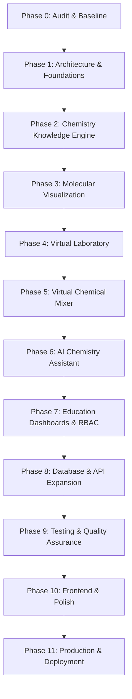

# Proton Pages — 11-Phase Master Expansion Roadmap

**Status**: Active  
**Objective**: Build a production-grade Chemistry Intelligence, Virtual Laboratory, and Education Platform.  
**Targets**: 600,000+ verified LOC | 100+ PRs | 100+ commits.

---

## Architecture Milestone Flow

---

## Phase Breakdown

### Phase 0: Repository Audit & Quality Baseline (Completed)
- Complete dependency inventory, Git cleanup, baseline metrics script, test suites.
- Deliverables: [REPOSITORY_AUDIT.md](file:///d:/proton%20pages/docs/architecture/REPOSITORY_AUDIT.md), [BASELINE_METRICS.md](file:///d:/proton%20pages/docs/quality/BASELINE_METRICS.md).

### Phase 1: Architecture and Foundations (In Progress)
- FastAPI Gateway (`/api/v1/chemistry/...`), OpenAPI docs, health checks.
- PostgreSQL models & Alembic migrations (`users`, `user_sessions`, `chemical_bookmarks`, `experiment_records`).
- Docker Compose, `.env.example`, Vitest test setup, GitHub Actions CI.

### Phase 2: Chemistry Knowledge Engine Expansion
- Advanced thermochemistry: Hess's Law, enthalpy of formation ($\Delta H_f^\circ$), heat capacities $C_p(T)$.
- Electrochemistry: Standard cell reduction potentials, Nernst equation solver, Latimer diagrams.
- Acid-Base Equilibrium: Polyprotic acid ionization cascades ($K_{a1}, K_{a2}$), buffer capacity $\beta$.
- Chemical Kinetics: Arrhenius parameters, integrated rate laws, activation energy solver.
- Scientific verification suite against NIST / CRC Chemistry references.

### Phase 3: Molecular Visualization & Topology
- 2D chemical structure drawing canvas with bond snapping, aromatic ring shortcuts, and formal charges.
- 3D ball-and-stick / space-filling enhancements in Three.js: electrostatic surface maps, dihedral angle rotation.
- SMILES, InChI, and PDB molecular format parser and exporters.

### Phase 4: Virtual Chemistry Laboratory
- Titration rig: Automated burette, pH glass electrode, indicator color transitions, titration curve derivative graphing.
- Calorimeter rig: Constant-volume bomb calorimeter and constant-pressure coffee-cup calorimeter physics.
- Reagent shelf, safety warnings, and experimental observation log persistence.

### Phase 5: Virtual Chemical Mixer
- Dedicated, testable mixing simulation engine:
  - Precipitation rules matrix ($K_{sp}$ solubility product comparisons).
  - Acid-base neutralization and exothermic temperature shifts.
  - Gas evolution tracking ($\text{CO}_2, \text{H}_2, \text{SO}_2, \text{NH}_3$).
  - Chemical compatibility and hazard alerts (NFPA 704 ratings).
  - Simulation log export to user lab notebook.

### Phase 6: AI Chemistry Assistant
- Grounded step-by-step chemical problem solver.
- Equation balancing and stoichiometry tutoring with deterministic scientific validation.
- Provider-agnostic model integration with fallback and strict rate-limiting.

### Phase 7: Education Platform & Dashboards
- Student Dashboard: Active courses, virtual lab rigs, saved experiments, streak tracking.
- Teacher Dashboard: Assignment creation, experiment rubric authoring, student submission grading drawer.
- Administrator Dashboard: User management, cohort analytics, audit logging.

### Phase 8: Database & API Expansion
- Full REST endpoints for `/api/v1/users`, `/api/v1/auth`, `/api/v1/bookmarks`, `/api/v1/experiments`.
- JWT authentication, session tokens, and role-based permissions.
- Repository pattern and transaction management.

### Phase 9: Testing & Quality Verification
- End-to-end Playwright tests for student workflows.
- Property-based testing for thermodynamic and equilibrium solvers.
- Security review: injection prevention, password hashing audits, rate limiting.

### Phase 10: Frontend Design System & Polish
- Stitch scientific design tokens (Parchment `#FDF8F5`, Copper `#D47942`, Amber `#8B572A`, Charcoal `#2C302E`).
- Accessible form controls, high-contrast scientific notation typography, keyboard navigation.

### Phase 11: Production Operations & Hardening
- Production multi-stage Docker builds, Nginx reverse proxy configuration.
- Observability: Prometheus metrics, structured JSON audit logs, health probes.
- Final LOC accounting and versioned tagged release `v1.0.0`.
