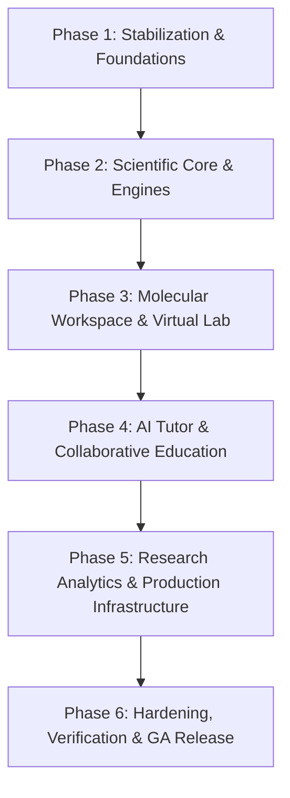

# Proton Pages — Master Implementation Roadmap & Backlog

**Version**: 1.0.0  
**Status**: Active  
**Repository**: [https://github.com/Gopi2870/Proton-pages](https://github.com/Gopi2870/Proton-pages)  
**Target Metrics**: 500,000+ meaningful verified LOC | 120+ PRs | 150+ commits across 6 sequential phases.

---

## 1. Roadmap Architecture Overview

---

## 2. Phase 1 — Repository Stabilization and Platform Foundations

**Goal**: Transform the current codebase into a clean, reproducible monorepo with robust testing, CI/CD quality gates, unified design tokens, full frontend page routing, and clean backend/database foundations.

### Planned Pull Requests & Issues (PRs #16 to #35)

#### Batch 1.1: Git Hygiene, Tooling & Quality Gates (Immediate First Batch)
- [ ] **PR-016** (`chore/git-hygiene-and-ignores`): Untrack 46 tracked compiled `.pyc` files, update `.gitignore` for Python (`__pycache__`, `*.pyc`, `.pytest_cache`, `.coverage`, `.venv`), and verify clean Git status.
- [ ] **PR-017** (`chore/ci-cd-quality-pipelines`): Implement GitHub Actions workflow (`.github/workflows/ci.yml`) running TypeScript type check, Vite build, Python pytest suite with coverage checks, and automated LOC reporting.
- [ ] **PR-018** (`feat/frontend-vitest-test-suite`): Add Vitest, `@testing-library/react`, and jsdom to frontend. Create initial test suite for `scientificCalculators.ts`, `unitConverter.ts`, and core UI components.
- [ ] **PR-019** (`refactor/frontend-complete-routing`): Update `src/types/navigation.ts`, `src/App.tsx`, and `Sidebar.tsx` to route all unwired pages (`ChemicalMixerPage`, `ReactionDatabasePage`, `FunctionalGroupsPage`, `CarbonStructuresPage`, `IsomersPage`, `AssignmentsPage`, `HelpDocsPage`, `SettingsPage`, `InstitutionDashboardPage`).
- [ ] **PR-020** (`fix/chemistry-validation-consistency`): Harmonize frontend `ChemicalFormulaValidator` with backend tokenizer principles to prevent parenthesis parsing bugs (`Ca(OH)2`).

#### Batch 1.2: Backend Service Architecture & Database Schema
- [ ] **PR-021** (`feat/chemistry-api-gateway`): Create FastAPI HTTP/WebSocket gateway in `services/chemistry` exposing `ChemistryEngine` endpoints with OpenAPI schema docs and CORS configuration.
- [ ] **PR-022** (`feat/database-models-and-migrations`): Configure PostgreSQL database schema, SQLAlchemy 2.0 async models, and Alembic migrations for users, roles, chemical bookmarks, and experiment logs.
- [ ] **PR-023** (`feat/auth-and-rbac`): Implement JWT authentication, session management, and Role-Based Access Control (`Student`, `Teacher`, `Researcher`, `Admin`).
- [ ] **PR-024** (`feat/structured-logging-and-errors`): Add structured JSON logging (correlation IDs), standard error envelope schemas, and security headers (CSP, CORS, rate limits).
- [ ] **PR-025** (`feat/docker-compose-reproducible-dev`): Create multi-stage `Dockerfile` and `docker-compose.yml` for unified local development (PostgreSQL, FastAPI backend, Vite frontend).

#### Batch 1.3: Component Library & Design System Hardening
- [ ] **PR-026** (`feat/design-system-tokens`): Formalize design tokens in Tailwind configuration for Parchment `#FDF8F5`, Copper `#D47942`, Amber `#8B572A`, Charcoal `#2C302E` with accessibility contrast verification.
- [ ] **PR-027** (`feat/accessible-form-controls`): Build reusable accessible inputs, selects, numeric scientific steppers, and formula input fields with live validation feedback.
- [ ] **PR-028** (`feat/chemical-notation-typography`): Add LaTeX/MathML and Unicode sub/superscript chemical notation renderer component.
- [ ] **PR-029** (`test/e2e-playwright-setup`): Setup Playwright for end-to-end testing of core navigation, Periodic Table inspection, and Reaction Balancer.
- [ ] **PR-030** (`docs/architecture-and-dev-guide`): Comprehensive developer onboarding, architecture diagrams, and contribution guidelines in `docs/architecture/`.

---

## 3. Phase 2 — Chemistry Knowledge and Scientific Computation

**Goal**: Expand the domain layer into an exhaustive, scientifically validated chemistry intelligence engine.

### Key Milestones & PRs (PRs #36 to #60)
- **PR-036 to PR-040**: IUPAC organic nomenclature generator and SMILES/InChI parser.
- **PR-041 to PR-045**: Advanced thermodynamics matrix: Hess's Law solver, temperature-dependent enthalpy/entropy polynomials, and Van 't Hoff calculations.
- **PR-046 to PR-050**: Electrochemical cell simulator: standard reduction potentials database, Nernst equation solver, Latimer and Frost diagrams.
- **PR-051 to PR-055**: Quantum chemistry & spectroscopic prediction: IR vibrational modes, UV-Vis absorption transitions, and 1H/13C NMR shift estimations.
- **PR-056 to PR-060**: Reference dataset verification suite: provenance tracking, NIST/PubChem reference attribution, and automated scientific property regression testing.

---

## 4. Phase 3 — Molecular Workspace and Virtual Laboratory

**Goal**: Production-grade 2D/3D chemical drawing, conformational simulation, and realistic virtual apparatus experimentation.

### Key Milestones & PRs (PRs #61 to #85)
- **PR-061 to PR-065**: 2D chemical structure drawing canvas with bond snapping, aromatic ring tools, and charge assignment.
- **PR-066 to PR-070**: 3D ball-and-stick / space-filling molecular viewer enhancements: electrostatic potential surface mapping, dihedral angle rotation, and PDB/MOL export.
- **PR-071 to PR-075**: Dropwise acid-base titration rig with automated pH glass electrode simulation, buffer region modeling, and first/second derivative inflection curves.
- **PR-076 to PR-080**: Calorimetry rig with heat capacity calculations, solution enthalpies, and bomb calorimeter constant determination.
- **PR-081 to PR-085**: Chemical mixer simulation engine with reaction equilibrium, precipitate formation rules, gas evolution tracking, and hazard warning system.

---

## 5. Phase 4 — AI Tutor, Education and Collaboration

**Goal**: Grounded, verifiable AI pedagogical assistance and multi-tenant institutional classrooms.

### Key Milestones & PRs (PRs #86 to #105)
- **PR-086 to PR-090**: Provider-agnostic AI tutor service with step-by-step mechanism breakdown, deterministic validation of AI answers, and rate limiting.
- **PR-091 to PR-095**: Interactive homework generator with dynamic parameter randomization, automatic grading, and step-by-step hints.
- **PR-096 to PR-100**: Teacher assignment builder, rubric designer, cohort mastery analytics, and student submission review drawers.
- **PR-101 to PR-105**: Real-time collaborative research notebook with WebSocket synchronizations, student question queues, and institutional administrative controls.

---

## 6. Phase 5 — Research, Analytics and Production Engineering

**Goal**: Enterprise-grade performance, observability, asynchronous computation, and security compliance.

### Key Milestones & PRs (PRs #106 to #125)
- **PR-106 to PR-110**: Asynchronous batch reaction calculations and Celery/Redis worker task status tracking.
- **PR-111 to PR-115**: Advanced compound search with substructure matching, molecular fingerprint indexing, and PostgreSQL pgvector integration.
- **PR-116 to PR-120**: Comprehensive observability: Prometheus metrics, OpenTelemetry distributed tracing, structured audit logging, and health probe endpoints.
- **PR-121 to PR-125**: Production container orchestration, database backup/restore automated verification, and performance profiling benchmarks.

---

## 7. Phase 6 — Hardening, Integration and Release

**Goal**: End-to-end validation, security review, documentation, and formal versioned release.

### Key Milestones & PRs (PRs #126 to #145)
- **PR-126 to PR-130**: Complete regression test suite across all modules with >90% code coverage.
- **PR-131 to PR-135**: Security audit, dependency vulnerability remediation (Dependabot/Snyk), CSP headers, and rate limiting validation.
- **PR-136 to PR-140**: WCAG 2.1 AA accessibility verification, high-contrast mode, and keyboard navigation testing.
- **PR-141 to PR-145**: Final verification: LOC accounting report, tagged production release (`v3.0.0`), deployment runbooks, and user documentation.

---

## 8. LOC Milestones Tracking

| Phase | Milestone | Est. Added LOC | Cumulative LOC Target |
| :--- | :--- | :---: | :---: |
| **Baseline** | Initial Audit | — | 78,744 |
| **Phase 1** | Foundations, CI/CD, Routing, DB & Tests | +40,000 | ~120,000 |
| **Phase 2** | Scientific Computing & Chemistry Knowledge | +90,000 | ~210,000 |
| **Phase 3** | Virtual Lab & Molecular Workspace | +110,000 | ~320,000 |
| **Phase 4** | AI Tutor, Education & Collaboration | +85,000 | ~405,000 |
| **Phase 5** | Research Engines, Infrastructure & Analytics | +65,000 | ~470,000 |
| **Phase 6** | Hardening, Integration, Security & Docs | +35,000 | **505,000+** |
